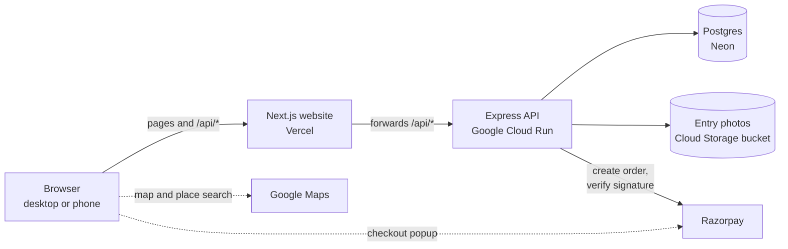

# ParkSpotZ — Interview Prep

A study guide for talking about this project in an interview. It covers the pitch, the architecture, model answers to the questions most likely to come up, the project's weaknesses, and a practice plan. File references point at the code so every answer can be checked against what is actually there.

Live site: https://parkspotz.vercel.app · Code: https://github.com/svasudev79/parkspotz

---

## 1. How to frame your role

The chat history in this repository shows the app was built with an AI coding assistant. Say so before anyone asks, then be specific about what was yours:

- **Problem and spec.** You wrote [Goal-spec.md](Goal-spec.md): the problem, the users, the phases.
- **Product decisions.** Guest booking, the attendant role, hiding revenue from attendants, overstay rules, tiered monthly rental, "flag only" for unpaid rental.
- **Engineering trade-offs.** One-day scope cuts, a free hosted database over an always-on one, test payment keys before live ones, an installable web app deferred to Phase 2.
- **Delivery.** You tested the flows, supplied and restricted the API keys, and got it deployed across three services.

A line that works: *"I specified and directed the build using an AI assistant, reviewed what it produced, and I can walk you through any part of the design."* Then make that true by working through sections 4 and 8.

Do not claim to have hand-written the code. The follow-up questions will find the gap, and the commit history shows the co-author.

---

## 2. The two-minute pitch

> Finding parking in Bangalore is fragmented, and there is no simple way to book and pay for a spot before you arrive. ParkSpotZ lets a customer search near a destination, see which parking spaces have free slots for a chosen time, book, pay, and get a receipt with a QR code.
>
> There are four kinds of user. Customers book, with or without an account. Space owners list their parking, see usage and revenue, and pay a monthly fee to be listed. Gate attendants scan the QR, record entry and exit with a photo, and collect any overstay charge. And I have an admin view of how many spaces and slots are on the platform and how well they are used.
>
> It is a Next.js site on Vercel, an Express and TypeScript API on Google Cloud Run, Postgres on Neon, Razorpay for payments and Google Maps for search. It is live, in Razorpay test mode with demo data.
>
> The parts I find most interesting are making sure two people cannot book the last slot, and verifying payments on the server.

Then offer the demo: the live site, or the 3-minute video in `demo/`.

---

## 3. Architecture

Practise drawing this from memory.



| Part | Choice | Why |
|------|--------|-----|
| Website | Next.js on Vercel | Server-rendered pages, simple deploys from GitHub |
| API | Express + TypeScript on Cloud Run | Small and explicit; scales to zero, so it costs nothing when idle |
| Database | Postgres (Neon) | Bookings need transactions and row locks; Neon's free tier avoids an always-on bill |
| Payments | Razorpay | UPI and cards in India; test mode for the pilot |
| Maps | Google Maps JS + Places | Destination search and the results map |
| Photos | Cloud Storage bucket mounted as a folder | Cloud Run's own disk is wiped on restart |

**Why the browser never calls the API directly.** The website forwards `/api/*` to the API (`frontend/next.config.ts`). The login cookie is therefore set for the website's own domain. If the browser called the API on a different domain, Safari on iPhone would block the cookie as third-party and nobody could log in.

**Four roles**, enforced on every API route by `requireRole` in `backend/src/middleware/auth.ts`: `customer`, `owner`, `attendant`, `admin`. Guests have no role; they are identified by a token (section 4.5).

---

## 4. Likely technical questions, with model answers

### 4.1 How do you stop two people booking the last slot?

*Where:* `createBooking` in `backend/src/booking-service.ts`.

> A space has a number of slots, not individual slot records. Creating a booking runs in one database transaction. It first locks that parking space's row with `SELECT … FOR UPDATE`. Then it counts the bookings that overlap the requested time and still hold a slot. Only if that count is below the space's total does it insert the new booking, and then it commits.
>
> Because of the row lock, a second request for the same space has to wait until the first commits. When it gets its turn, its count includes the first booking, so it is refused with a 409. Without the lock, both requests could count "one slot free" at the same moment and both insert.

*Follow-ups to expect:*
- **Why lock the space row and not the bookings?** There may be no existing booking row to lock; the space row always exists and is the natural thing every booking for that space contends on.
- **Does it scale?** Locks are per space, so bookings for different spaces never wait on each other. Contention only exists for the same space at the same instant.
- **How was it tested?** An automated test fires two bookings at once for a one-slot space and asserts exactly one succeeds (`backend/test/booking.test.ts`).

### 4.2 How do you work out availability for a time window?

*Where:* `backend/src/availability.ts`.

> Available slots = total slots minus the bookings that overlap the window and still hold a slot. Two windows overlap when each starts before the other ends: `start_time < requested_end AND end_time > requested_start`. Windows that only touch, like 10–12 and 12–14, do not overlap.
>
> A booking holds a slot if it is confirmed, or if it is pending and less than ten minutes old. That second part is how abandoned checkouts are handled: there is no background job, an unpaid booking simply stops counting once it is older than the hold time.
>
> Search and booking share the same SQL, so they can never disagree about what is free.

### 4.3 How do you know a payment is genuine?

*Where:* `backend/src/payments.ts` and `confirmBooking` in `booking-service.ts`.

> Three things. First, the amount is computed on the server from the space's hourly price and the duration; anything the browser sends as an amount is ignored. Second, the server creates the Razorpay order itself, so the amount Razorpay charges is the server's figure. Third, after checkout the browser sends back the order id, payment id and a signature. Razorpay produces that signature by signing "order id | payment id" with a secret only my server and Razorpay know. The server recomputes it with HMAC-SHA256 and compares, using a constant-time comparison. It also checks the order id matches the one stored for that booking.
>
> The confirming update only succeeds if the booking is still pending and still inside its hold, so a booking cannot be confirmed twice, and confirming an already confirmed booking is a no-op.

*Follow-up — what is the weakness?* There is no payment webhook. If the customer pays but closes the browser before returning, the server never hears about it. And if someone pays after the ten-minute hold has expired, the payment has gone through at Razorpay but the booking is refused, with no refund flow. Both are fixed by adding Razorpay's webhook and a refund path. Know this one; it is the most serious gap in the payment design.

### 4.4 How do login and permissions work?

*Where:* `backend/src/session.ts`, `backend/src/middleware/auth.ts`, `backend/src/routes/auth.ts`.

> Passwords are stored as bcrypt hashes. On login the server issues a signed JWT containing the user id and role, in a cookie that is `HttpOnly` so page scripts cannot read it, `Secure` in production, and `SameSite=Lax` as protection against cross-site requests. It lasts seven days.
>
> Every API route declares which roles may use it. Beyond role, ownership is checked in the query itself: an owner's query filters by their own id, and an attendant's space comes from their session, never from a value the browser sends. Asking for someone else's booking returns 404, not 403, so the API does not confirm that it exists.

*Follow-up — downside of JWT sessions?* They cannot be revoked individually before expiry. The app handles the one case that matters, a removed attendant, by checking an `is_active` flag in the database on the attendant's queries and at login.

### 4.5 How does a guest own a booking with no account?

*Where:* `backend/src/guest.ts`, `backend/src/routes/guest.ts`.

> A guest gives a name and mobile number. The booking gets a random 32-byte access token. That token is the guest's proof of ownership: it is kept in a signed, HttpOnly cookie in their browser and it is in their private receipt link. Every guest action is authorised by that token, and anything else returns 404. The receipt page is marked no-index and no-referrer so the link does not leak.
>
> If the guest later signs up or logs in as a customer on the same browser, their guest bookings are attached to the account.
>
> Because anonymous users can now hold slots, there are limits: at most two unpaid bookings at a time per browser, per IP address and per mobile number.

*Weakness:* the phone number is not verified, so there is no OTP, and a lost receipt link can only be recovered from the same browser.

### 4.6 How does "near me" search work?

*Where:* `backend/src/routes/spaces.ts`.

> The destination is turned into a latitude and longitude by Google Places. The API then computes the great-circle distance from that point to every active space using the Haversine formula in SQL, keeps those within the chosen radius, and sorts by distance.
>
> That is a scan over all spaces, which is fine for hundreds or a few thousand. At larger scale I would add PostGIS with a spatial index, or at least a bounding-box filter on indexed lat/lng columns before the exact calculation.

### 4.7 What happens at the gate?

*Where:* `backend/src/gate.ts`, `backend/src/routes/visits.ts`, `backend/src/overstay.ts`.

> The receipt's QR code is a link containing an unguessable token. The attendant scans it with their phone camera. The API checks the booking is paid and belongs to that attendant's space, and says whether it is upcoming, current or over.
>
> The attendant records entry, optionally with a vehicle number and a photo. There is a unique constraint on the booking in the visits table, so a booking can only ever be used for one entry, even if two attendants scan at the same moment. While the car is inside, the screen shows a countdown to the end of the booked time.
>
> At exit the server works out any overstay from its own clock: ten minutes free, then charged from the booked end in started 30-minute blocks at the hourly rate. If something is owed, the attendant must record how it was settled — cash, UPI or waived with a reason — before the exit is saved.

*The design choice worth mentioning:* attendants never receive booking amounts or revenue in any API response; the one exception is the overstay amount for the single vehicle in front of them, because they have to collect it.

### 4.8 How does the monthly rental work?

*Where:* `backend/src/rental.ts`, `backend/src/routes/rental.ts`, `backend/src/routes/admin.ts`.

> Owners pay a monthly fee per listed space, tiered by number of slots. Tiers are stored in the database and editable by the admin, with validation that they have no gaps or overlaps. Each space gets one invoice per calendar month, enforced by a unique constraint. The fee is copied onto the invoice when it is created, so changing a tier later does not rewrite history. Invoices are generated on demand when the relevant pages load, in a way that is safe to run repeatedly and concurrently, so no scheduler is needed. Owners pay through the same payment code as bookings.

### 4.9 How did you test it?

> There are 42 automated API tests using Node's built-in test runner against a separate test database. They concentrate on the rules that would fail silently: the last-slot race, overlap boundaries, overstay rounding at 10, 11, 30 and 31 minutes, double entry and double exit, and that no role can reach another role's data. On top of that there is a written test plan in the solution outline that was run through the browser, and the deployed site was checked with an admin diagnostics endpoint.
>
> What is not covered: there are no automated browser tests, and Razorpay was only exercised by hand.

### 4.10 How is it deployed, and what does it cost?

> The website deploys automatically from GitHub to Vercel. The API is a container built on Google Cloud Build and run on Cloud Run. Secrets — the database address, the signing secret and the Razorpay secret — are in Google Secret Manager, not in the code or plain environment variables. The API refuses to start in production if it is in test-payment mode, if the signing secret is weak, or if the site address is not HTTPS.
>
> At pilot traffic it costs close to nothing: Cloud Run and Neon are within free tiers, and storage is a few cents. The always-on alternative, Cloud SQL, would have been roughly ten to fifteen dollars a month, which is why I chose Neon for now. There is a budget alert on the Google Cloud project.

---

## 5. Product and judgement questions

**Why build this?** Lead with the user problem from the spec, not the technology.

**How did you decide what to leave out?** Phase 1 was scoped to a day. Cut: webhook, refunds, numbered slots, notifications, password reset, native app. The rule was that the spec's success metrics — log in, search, see availability on a map, onboard a space — had to work first.

**A decision you changed your mind on.** The mobile plan: an installable web app was designed, then moved to Phase 2 so Phase 1 stayed a responsive site that opens in a phone browser.

**How would you get the first real owners?** Have an answer. The demo spaces are made up; a real launch needs real listings, and the open question in the spec about who enters public and metro parking is exactly this.

**How does it make money?** Monthly rental per listed space, tiered by size. Be ready to discuss the alternative, a commission per booking, and why a flat fee is simpler to explain and bill.

**What would you measure?** Searches that end in a booking, bookings per space per day, slot utilisation (already on the admin dashboard), abandoned payments, overstay rate.

---

## 6. Weaknesses to raise yourself

Naming these before the interviewer does shows judgement. Each has a one-line fix.

| Weakness | Fix |
|----------|-----|
| No payment webhook; a payment after the hold expires is not refunded | Razorpay webhook plus a refund path |
| Guest phone numbers are unverified | OTP at guest checkout |
| No cancellations or refunds | Cancellation policy and Razorpay refunds API |
| Bookings cannot cross midnight | Model opening hours per day and allow multi-day windows |
| Overstay is cash or UPI at the gate, unverified | Charge it online against the original payment method |
| No password reset, no login rate limiting | Email or SMS reset; rate limit by account and IP |
| Number plates, photos and phone numbers kept indefinitely | Retention policy and a deletion job |
| Sessions cannot be revoked before they expire | Server-side session store, or short-lived tokens with refresh |
| Distance search scans every space | PostGIS index |
| No automated browser tests | Playwright suite for the main journeys |
| Runs on test keys and demo data | Razorpay KYC, remove demo data, Vercel Pro for commercial use |

The full list is under "Known limitations" in [README.md](README.md).

---

## 7. Stories to have ready

Use situation → what you did → result.

1. **A cost trade-off.** The database was the only always-on cost. You compared Cloud SQL at roughly US$10–15 a month with a free hosted Postgres, accepted the cold-start delay and a third vendor, and noted that moving later is a data copy and one setting.
2. **Something that went wrong.** Pick one and know the details:
   - The first GitHub push failed three different ways: password authentication is no longer accepted, then the token lacked write permission, then GitHub's email privacy setting rejected the commit. Each error message said what was wrong.
   - The Google Cloud tool would not install because a settings folder in the home directory was owned by root, and a mistyped path unpacked two copies into the project.
   - The first map fix left the map blank because of a zoom option that the map type did not support; it was caught on the local copy before it went live.
3. **A design decision with a principle behind it.** Attendants see no revenue, but do see one vehicle's overstay amount. The principle: give each role the least information it needs to do its job.
4. **Security hygiene.** The chat history is public, so keys and passwords were never pasted into it; they live in ignored local files and in Secret Manager, and the export is scanned before every commit. The Maps key is restricted to the site's address.

---

## 8. Practice plan

**Read these files, in this order** (about 800 lines in total):

1. `backend/schema.sql` — the data model
2. `backend/src/availability.ts` — 29 lines; the heart of the booking rule
3. `backend/src/booking-service.ts` — create, confirm and fail a booking
4. `backend/src/payments.ts` — order creation and signature check
5. `backend/src/middleware/auth.ts` and `backend/src/session.ts` — roles and sessions
6. `backend/src/overstay.ts` — the overstay rule
7. `backend/test/booking.test.ts` — the last-slot and overlap tests

**Then do these:**

- [ ] Draw the architecture diagram from memory and explain every arrow.
- [ ] Explain 4.1 and 4.3 aloud, without notes, until each takes under two minutes.
- [ ] Run the app locally and follow one booking from search to receipt while reading the code.
- [ ] Run `npm test` in `backend/` and read the names of the tests.
- [ ] Do the live demo three times: guest booking, attendant entry and exit, owner rental, admin dashboard.
- [ ] Pick two weaknesses from section 6 and be able to sketch the fix on a whiteboard.
- [ ] Prepare your answer to "what was your contribution?" and say it aloud.

**Run it locally:**

```bash
cd backend && npm run db:start && npm run dev
```

```bash
cd frontend && npm run dev
```

Demo logins and the rest of the setup are in [README.md](README.md).

---

## 9. Numbers worth remembering

- 4 roles, plus guests
- 9 database tables
- 42 automated tests
- 10-minute payment hold; 15-minute early-entry window; 10-minute overstay grace, then 30-minute blocks
- Bookings from 30 minutes up to 24 hours, within one day
- 3 rental tiers: up to 20 slots, 21–100, over 100
- 3 hosting services: Vercel, Google Cloud Run, Neon

---

## 10. Questions to ask the interviewer

- How do you handle payment reconciliation and failed webhooks in your systems?
- Where do you draw the line between database constraints and application checks?
- How is AI-assisted development used on the team, and how is the output reviewed?
- What does a first project for someone in this role usually look like?
